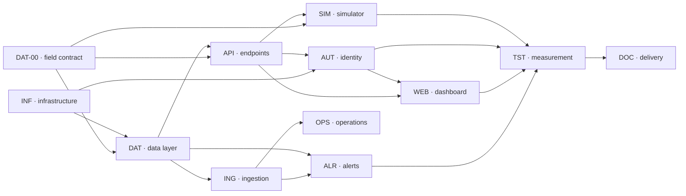

# Real-Time Patient Vital Signs Monitoring — Architecture and Project Plan

**Course:** MSML 650 Cloud Computing, Fall 2026 · University of Maryland
**Team:** 6 members, all contributing across the workstreams in §7. The repository was created by Tanmay Sharma, who also coordinates the board and maintains the SAM template.
**Document status:** v1 baseline, 2026-11-17. Supersedes the original project checklist where the two disagree; deviations are listed in §12.

---

## 1. Problem statement

Clinical staff monitoring multiple patients need abnormal vital signs surfaced within seconds, not minutes, and need a record of which alerts were seen and acted on. A polling-based human workflow scales badly: as patient count rises, time-to-notice rises with it.

This project builds a serverless AWS application that ingests a continuous stream of patient vital-sign readings, evaluates each reading against configurable clinical thresholds, raises and tracks alerts through an acknowledgement and resolution lifecycle, and presents live patient state on an authenticated web dashboard.

**Scope boundary.** This is an educational prototype, not a medical device. All patient identifiers and readings are synthetic and generated by a simulator in this repository. No real patient data is used at any point. All alert thresholds are project settings chosen for demonstration purposes and are not medical guidance.

### What we are building

| Layer | Implementation |
|---|---|
| Data source | Python simulator producing synthetic readings for 3 patients (P001–P003) across 4 scenarios |
| Ingestion | Amazon API Gateway HTTP API → AWS Lambda (validation, alert evaluation, persistence) |
| Storage | Amazon DynamoDB — 3 tables (current state, reading history with TTL, alert lifecycle) |
| Read path | AWS Lambda behind API Gateway serving 4 read/update routes |
| Presentation | React (Vite) dashboard, polling every 3 s, hosted on Amazon S3 behind Amazon CloudFront |
| Identity | Amazon Cognito user pool, JWT authorizer on protected routes |
| Operations | Amazon CloudWatch logs with 7-day retention, AWS Budgets cost alert |
| Delivery | AWS SAM (infrastructure as code), GitHub Actions CI, per-developer stacks |

**Region:** `us-east-1` for all resources, without exception.

### Success criteria

These are the measured claims the project stands behind. Each has a corresponding `TST` task that produces raw evidence and a calculation.

| # | Criterion | Target | Measured by |
|---|---|---|---|
| SC-1 | Dashboard latency: reading generation → visible on dashboard | < 5 s | TST-07 |
| SC-2 | Emergency detection rate across an injected scenario set | ≥ 95 % | TST-08 |
| SC-3 | Alert creation delay: first qualifying critical reading → alert row | < 10 s | TST-09 |
| SC-4 | Sustained ingestion throughput | ~100 readings/s | TST-10 |
| SC-5 | Duplicate, out-of-order, late and disconnected-device cases behave correctly | Repeatable pass | TST-03, TST-04 |
| SC-6 | Unauthenticated requests cannot reach protected endpoints | 401/403 | TST-06 |

A target that measurement does not meet is reported as not met. The team does not claim a figure the evidence does not support.

---

## 2. Architecture

### 2.1 End-to-end request flow

```
  ┌────────────────────────────────────────┐
  │  SIMULATOR  (team member's laptop)     │
  │  python simulator.py \                 │
  │    --api-url $API_URL \                │
  │    --scenario falling_oxygen           │
  │                                        │
  │  3 synthetic patients: P001 P002 P003  │
  │  Fields: reading_id, patient_id,       │
  │    device_id, timestamp, heart_rate,   │
  │    spo2, temperature_c,                │
  │    systolic_bp, diastolic_bp           │
  └───────────────────┬────────────────────┘
                      │  HTTPS  POST /readings
                      │  { "readings": [ {...}, {...}, {...} ] }
                      ▼
  ┌────────────────────────────────────────┐
  │  AMAZON API GATEWAY  (HTTP API)        │
  │  ─ POST   /readings            (ingest)│
  │  ─ GET    /patients            (JWT)   │
  │  ─ GET    /patients/{id}/readings (JWT)│
  │  ─ GET    /alerts              (JWT)   │
  │  ─ PATCH  /alerts/{alert_id}   (JWT)   │
  │                                        │
  │  CORS: CloudFront origin only          │
  │  OPTIONS preflight bypasses authorizer │
  └──────┬──────────────────────┬──────────┘
         │                      │
         ▼                      ▼
  ┌──────────────┐      ┌──────────────────┐
  │ INGEST       │      │ API              │
  │ LAMBDA       │      │ LAMBDA           │
  │              │      │                  │
  │ 1 validate   │      │ reads current    │
  │ 2 dedup by   │      │ state, history,  │
  │   reading_id │      │ alerts; computes │
  │ 3 order check│      │ connection state │
  │ 4 eval rules │      │ from             │
  │ 5 persist    │      │ latest_reading_at│
  │ 6 raise alert│      │ ack / resolve    │
  └──────┬───────┘      └────────┬─────────┘
         │                       │
         └───────────┬───────────┘
                     ▼
  ┌────────────────────────────────────────┐
  │  AMAZON DYNAMODB  (on-demand)          │
  │                                        │
  │  patient-monitoring-{env}-patients     │
  │    PK patient_id                       │
  │  patient-monitoring-{env}-readings     │
  │    PK patient_id · SK reading_time     │
  │    TTL expires_at                      │
  │  patient-monitoring-{env}-alerts       │
  │    PK alert_id                         │
  │    GSI1 patient_rule · status          │
  │    GSI2 status · created_at            │
  └────────────────────────────────────────┘
                     ▲
                     │  GET every 3 s  (Authorization: Bearer <JWT>)
  ┌──────────────────┴─────────────────────┐
  │  REACT DASHBOARD  (Vite build)         │
  │  S3 bucket  ──►  CloudFront distribution│
  │                                        │
  │  ─ patient overview cards              │
  │  ─ patient detail + trend charts       │
  │  ─ active alert panel (ack / resolve)  │
  │  ─ device connection state             │
  └──────────────────┬─────────────────────┘
                     │  login / logout
                     ▼
  ┌────────────────────────────────────────┐
  │  AMAZON COGNITO                        │
  │  user pool + app client (no secret)    │
  │  issues JWT ──► API Gateway authorizer │
  │  demo users only, synthetic            │
  └────────────────────────────────────────┘

  ┌────────────────────────────────────────┐
  │  AMAZON CLOUDWATCH   7-day retention   │
  │  AWS BUDGETS         cost alert        │
  └────────────────────────────────────────┘
```

### 2.2 Why serverless

Every component bills per use and costs nothing at idle. This is what makes the per-developer environment model in §4 viable: seven parallel copies of the stack cost approximately what one copy costs, because there is no instance-hour or provisioned-capacity component anywhere in the design. The architecture would not support this model if it contained an Amazon RDS instance, an Amazon EC2 instance or a NAT gateway — none of which this project creates.

### 2.3 Data model

**`patients` — current state, one item per patient**

```json
{
  "patient_id": "P002",
  "device_id": "DEV-P002-01",
  "latest_reading_at": "2026-11-17T14:22:03Z",
  "latest_reading_id": "r-8f3c1a",
  "heart_rate": 118,
  "spo2": 88,
  "temperature_c": 37.2,
  "systolic_bp": 142,
  "diastolic_bp": 91,
  "status": "critical",
  "consecutive_abnormal": 3,
  "consecutive_normal": 0
}
```

Access pattern: `GET /patients` performs a Scan over at most 3 items, which is acceptable at this cardinality and documented as such. Per-patient lookup is GetItem by key.

**`readings` — history**

```json
{
  "patient_id": "P002",
  "reading_time": "2026-11-17T14:22:03Z",
  "reading_id": "r-8f3c1a",
  "device_id": "DEV-P002-01",
  "heart_rate": 118,
  "spo2": 88,
  "temperature_c": 37.2,
  "systolic_bp": 142,
  "diastolic_bp": 91,
  "expires_at": 1763400000
}
```

Composite key `patient_id` + `reading_time` means history retrieval is a Query bounded by partition, never a Scan. TTL on `expires_at` removes demo history automatically so storage does not grow unbounded across the semester.

**`alerts` — lifecycle**

```json
{
  "alert_id": "a-5d21e9",
  "patient_id": "P002",
  "rule": "low_spo2",
  "severity": "critical",
  "status": "active",
  "patient_rule": "P002#low_spo2",
  "created_at": "2026-11-17T14:22:05Z",
  "acknowledged_by": null,
  "acknowledged_at": null,
  "resolved_at": null
}
```

Two global secondary indexes are required, and this is a correction to the original design:

- **GSI1** — PK `patient_rule`, SK `status`. Supports duplicate-active-alert suppression: before creating an alert, query for an existing `active` alert on the same patient and rule. Without this index, suppression requires a full table Scan on every critical reading.
- **GSI2** — PK `status`, SK `created_at`. Supports `GET /alerts?status=active` sorted by creation time, which is what the dashboard alert panel needs.

A table keyed only on `alert_id` cannot serve either query. This is designed in at `DAT-04` rather than discovered during alert implementation.

### 2.4 Alert rules

Thresholds live in configuration or Lambda environment variables, not scattered as literals through the handler, so tuning for the demo does not require editing multiple source files.

| Rule | Warning | Critical |
|---|---|---|
| `low_spo2` | ≤ 92 % | ≤ 89 % |
| `high_heart_rate` | ≥ 110 bpm | ≥ 130 bpm |
| `fever` | ≥ 38.0 °C | ≥ 39.0 °C |
| `abnormal_bp` | systolic ≥ 140 or diastolic ≥ 90 | systolic ≥ 160 or diastolic ≥ 100 |
| `combination` | two or more warning rules concurrently | — |

Starting values only; the team tunes them during `ALR-01`. Every threshold is labelled in code and documentation as an educational project setting.

**Debounce.** Noisy single readings do not raise alerts. A rule fires after N consecutive qualifying readings (default N=2, configurable) and resolves after M consecutive normal readings (default M=3). This is tracked in the `patients` item via `consecutive_abnormal` / `consecutive_normal`.

**Lifecycle.** `active` → `acknowledged` (records the signed-in Cognito user identifier and a UTC timestamp) → `resolved` (records a UTC timestamp). Resolution preserves the row; alert history is never deleted. One clinical episode produces exactly one alert row, enforced by the GSI1 suppression query.

### 2.5 Reliability behaviours

| Case | Behaviour |
|---|---|
| Duplicate reading (same `reading_id`) | Conditional write on `attribute_not_exists(reading_id)`; counted as duplicate, not re-processed, no second alert |
| Out-of-order reading | Stored in `readings`; `patients` current state updated only if `timestamp > latest_reading_at` |
| Late reading | Same as out-of-order — history accepts it, current state does not regress |
| Malformed reading | HTTP 400 with a useful but non-revealing error; counted as rejected |
| Disconnected device | Connection state derived at read time from `latest_reading_at`: `connected` < 15 s, `delayed` 15–30 s, `disconnected` > 30 s. Computed in the API Lambda, not stored, so no scheduled Lambda is required |

Every ingestion response returns counts for accepted, rejected and duplicate readings, and the Lambda emits one structured log line per request containing the request ID, those counts and the processing duration — no patient values in logs. These counts are what makes `TST-03` provable rather than assertable.

---

## 3. API contract (outline)

The authoritative contract lives in `docs/api.md` and is produced by **API-01 before any endpoint is implemented**. This ordering is deliberate: it is what allows dashboard work to proceed in parallel with backend work. Any PR that changes an endpoint updates `docs/api.md` in the same PR.

| Method | Route | Auth | Purpose |
|---|---|---|---|
| POST | `/readings` | restricted (see §4.4) | Ingest a batch of readings |
| GET | `/patients` | Cognito JWT | Current state + connection state for all patients |
| GET | `/patients/{patient_id}/readings` | Cognito JWT | History, `?limit=` and optional time range |
| GET | `/alerts` | Cognito JWT | Alerts filtered by `?status=active\|acknowledged\|resolved` |
| PATCH | `/alerts/{alert_id}` | Cognito JWT | Acknowledge or resolve |

Conventions: all timestamps are ISO-8601 UTC with a trailing `Z`. `limit` defaults to 100 and is capped at 500 so the dashboard cannot request unbounded history. Status codes: 400 invalid input, 401/403 auth failure, 404 missing record, 500 unexpected failure only.

---

## 4. Access control and environment model

### 4.1 Decision

**One shared AWS account, IAM users with prefix-scoped policies, infrastructure as code, one deployed stack per developer, plus one frozen demo stack.**

IAM answers *who may authenticate and what they may do*. The stack prefix answers *how many running copies exist and who owns each*. These are independent axes and this project uses both. Six separate AWS accounts was considered and rejected: it would forfeit centralised access control, split billing six ways, and leave no single system to demonstrate.

### 4.2 Environment model

One SAM template parameterised by `Env` produces a complete, independent stack per value:

```bash
sam deploy --stack-name patient-monitoring-tanmay \
           --parameter-overrides Env=tanmay
```

Each stack contains its own 3 DynamoDB tables, 2 Lambda functions, HTTP API with a distinct invoke URL, Cognito user pool and app client, and Lambda execution roles — all carrying the `patient-monitoring-{env}-` prefix.

| Stack | Deployed by | Purpose |
|---|---|---|
| `patient-monitoring-<name>` × 6 | each member | Development and isolated testing |
| `patient-monitoring-demo` | one designated member | Rehearsal and graded live demo; frozen before presentation |

The demo stack is deployed from a tagged commit on `main` and is not touched after the freeze. It exists to protect the 7 rubric points awarded for correct operation on demo day.

**Why isolation matters here specifically.** The design has 3 fixed patient IDs and global alert state. Two members running simulators concurrently against one set of tables would write to the same `patients` items, which invalidates the exact-count assertions in `TST-03` and the measured rates in `TST-08`/`TST-09` without any visible symptom. Isolation also removes the frontend/backend blocking dependency: a member can deploy a working backend from `main` in minutes rather than waiting on another member's branch.

### 4.3 IAM

Five collaborator IAM users in one group. The group policy uses the `${aws:username}` policy variable so a single document fences each user to their own prefix:

```json
{
  "Effect": "Allow",
  "Action": [
    "dynamodb:GetItem", "dynamodb:PutItem",
    "dynamodb:UpdateItem", "dynamodb:Query", "dynamodb:Scan"
  ],
  "Resource": [
    "arn:aws:dynamodb:us-east-1:<ACCOUNT_ID>:table/patient-monitoring-${aws:username}-*",
    "arn:aws:dynamodb:us-east-1:<ACCOUNT_ID>:table/patient-monitoring-${aws:username}-*/index/*"
  ]
}
```

ARN-pattern support varies by service, so each statement is verified against the service's IAM reference during `INF-03` rather than assumed.

**Known limitation, stated rather than hidden.** CloudFormation deployment requires `iam:CreateRole` and `iam:PassRole` to create Lambda execution roles. These are difficult to scope tightly, and a permission set that allows self-service deployment is close to power-user in practice. The project therefore claims *data-plane* least privilege, which the policy above genuinely delivers, and does not claim end-to-end least privilege. This distinction is stated in the presentation rather than glossed over.

**Credentials.** No long-lived access keys in the repository, ever. `.env` is gitignored and an `.env.example` with placeholder values is committed in its place.

### 4.4 Ingestion route protection

`POST /readings` is a write path into the database and is not left open. Decided during `AUT-04`; the two acceptable options are an API Gateway API key with a usage plan, or AWS IAM request signing from the simulator. The Cognito JWT authorizer is not used on this route because the simulator is not an interactive browser client.

### 4.5 Public repository discipline

The repository is public. Nothing in it is a credential, but the AWS account ID appears in ARNs and the invoke URL and user pool ID are deployment identifiers. All three stay in template parameters, CloudFormation outputs and gitignored environment files — never in committed source, documentation or screenshots.

### 4.6 Cost control

DynamoDB on-demand, Lambda and CloudFront have always-free monthly allowances that this project's load does not approach. API Gateway HTTP API requests bill from the first call on a post-July-2025 Free Plan account at roughly USD 1 per million requests; a dashboard polling every 3 s generates about 1,200 requests per hour, so the semester cost is measured in cents.

Two controls, both in `OPS`:
1. An AWS Budgets alert with a confirmed notification address. Budgets **notify after spend; they do not block it.** Whether a hard spend limit is available depends on the account's sign-up vintage and is checked during `OPS-03`.
2. `docs/cost-log.md` with a weekly dated entry from the Billing dashboard.

Standing rule: no simulator is left running unattended. The cost risk in this architecture is not the services, it is a forgotten loop.

---

## 5. Repository structure

```
real-time-patient-monitoring/
├── .github/
│   ├── CODEOWNERS                 # infra/ requires repo-owner review
│   ├── pull_request_template.md   # linked issue, evidence, test notes
│   └── workflows/
│       └── ci.yml                 # sam validate + pytest on every PR
├── infra/
│   ├── template.yaml              # SAM: all resources, Env-parameterised
│   ├── samconfig.toml
│   └── README.md                  # resource inventory, env vars, teardown
├── src/
│   ├── ingest/
│   │   ├── handler.py             # validate → dedup → order → persist → alerts
│   │   ├── validation.py
│   │   ├── alerts.py              # rule evaluation + lifecycle
│   │   └── config.py              # thresholds, debounce counts
│   ├── api/
│   │   ├── handler.py             # router for the 4 read/update routes
│   │   └── connection_state.py    # derives connected/delayed/disconnected
│   └── common/
│       ├── dynamo.py              # client, Decimal conversion helpers
│       └── models.py
├── simulator/
│   ├── simulator.py               # --scenario, --api-url, --pause-device
│   ├── scenarios.py
│   ├── requirements.txt
│   └── README.md                  # exact commands for local and AWS runs
├── frontend/
│   ├── src/
│   │   ├── pages/                 # Overview, PatientDetail
│   │   ├── components/            # PatientCard, TrendChart, AlertPanel
│   │   ├── auth/                  # Cognito login/logout
│   │   └── api/                   # client reading VITE_API_BASE_URL
│   ├── .env.example               # committed; .env is gitignored
│   ├── package.json
│   └── README.md                  # Node version, build, deploy commands
├── tests/
│   ├── unit/                      # validation, thresholds, dedup, ordering
│   ├── integration/               # live-stack endpoint tests
│   ├── load/                      # 100 readings/s harness
│   └── test-plan.md               # prerequisites, expected, actual, evidence
├── docs/
│   ├── architecture.md            # this document
│   ├── api.md                     # authoritative API contract
│   ├── data-dictionary.md         # every simulator field, type, range, units
│   ├── cost-log.md                # weekly billing entries
│   └── evidence/                  # screenshots and test output
├── .gitignore
├── CONTRIBUTING.md                # branch, PR, review rules
└── README.md
```

---

## 6. Branching and review workflow

GitHub Flow with enforced protection on `main`.

1. Every task has a GitHub Issue before work starts.
2. One task = one branch = one PR, branched from current `main`.
3. Branch naming: `<type>/<TASK-ID>-<short-description>` — e.g. `feat/ING-04-idempotent-writes`, `fix/API-07-cors-preflight`. The task ID ties issue → branch → PR → merge into one traceable chain, which is the individual-contribution evidence the course requires.
4. Rebase on `main` before opening the PR.
5. PR requires one approval **from anyone other than the author**. Review and merge duty rotates across all six members; no single member is the sole approver.
6. `infra/` is the single exception: `CODEOWNERS` auto-requests the template maintainer's review on any change there, because the template is shared state that affects every member's next deploy.
7. CI must pass: `sam validate` plus unit tests.
8. A task is done when its PR is merged and its definition of done in §8 is satisfied with evidence attached.

**Branch protection settings on `main`:** require a pull request before merging · require 1 approval · dismiss stale approvals on new commits · require status checks to pass · require conversation resolution · block direct pushes · block force pushes.

**Task sizing rule.** A task must be finishable in one sitting, roughly 2–4 hours. If it needs two sittings or two people, it is two tasks. This rule exists because the original checklist's phases ranged from one afternoon to two weeks, and a two-week branch produces an unmergeable diff.

---

## 7. Workstreams

Work is decomposed by workstream rather than by narrative phase, because a workstream maps to a skill set and an owner while a phase maps to neither.

| Code | Workstream | Tasks |
|---|---|---|
| `INF` | Infrastructure as code, IAM, CI, hosting | 8 |
| `DAT` | Field contract, DynamoDB design and resources | 6 |
| `SIM` | Simulator | 5 |
| `API` | Endpoints and the API contract | 7 |
| `ING` | Ingestion Lambda | 6 |
| `ALR` | Alert rules and lifecycle | 6 |
| `AUT` | Cognito and authorisation | 6 |
| `WEB` | React dashboard | 10 |
| `OPS` | Monitoring, logging, cost | 5 |
| `TST` | Test plan and success-criteria measurement | 11 |
| `DOC` | Documentation, status update, slides, demo | 8 |
| | **Total** | **78** |

---

## 8. Task breakdown with dependencies

Format: `ID · title · depends on` followed by the definition of done.

### INF — Infrastructure

| ID | Task | Depends on |
|---|---|---|
| INF-01 | SAM template skeleton with `Env` parameter | — |
| INF-02 | Repo scaffold: `.gitignore`, `CODEOWNERS`, PR template, `CONTRIBUTING.md` | — |
| INF-03 | IAM group and prefix-scoped collaborator policy | INF-01 |
| INF-04 | CI workflow: `sam validate` + pytest on PR | INF-02 |
| INF-05 | S3 bucket + CloudFront distribution for the frontend | INF-01 |
| INF-06 | Deploy and verify one personal stack end to end | INF-01, INF-03 |
| INF-07 | Demo stack created and freeze procedure documented | INF-06 |
| INF-08 | Teardown runbook: `sam delete` per stack, verified | INF-06 |

- **INF-01** — Template deploys cleanly with `Env` substituted into every resource name. No hardcoded names anywhere.
- **INF-02** — A new collaborator can clone and read `CONTRIBUTING.md` to learn the branch and PR rules without asking.
- **INF-03** — A collaborator can deploy their own stack and cannot read or write another member's tables. Verified by attempting both.
- **INF-04** — A PR with an invalid template or a failing test is blocked by CI.
- **INF-05** — Distribution domain recorded as a CloudFormation output. **This domain is an input to API-07 (CORS origin) and AUT-02 (callback URL)** — a dependency that did not exist under the localhost plan.
- **INF-06** — All resources `ACTIVE`; a sample item written and retrieved by key in each table.
- **INF-07** — Demo stack deployed from a tagged commit; freeze date and "no deploys after" rule written down.
- **INF-08** — Runbook tested by actually deleting a scratch stack and confirming zero residual resources.

### DAT — Data layer

| ID | Task | Depends on |
|---|---|---|
| DAT-00 | **Field contract / data dictionary** for every simulator field | — |
| DAT-01 | Table design document: items, keys, access patterns, GSIs | DAT-00 |
| DAT-02 | `patients` table in template | INF-01, DAT-01 |
| DAT-03 | `readings` table with TTL on `expires_at` | INF-01, DAT-01 |
| DAT-04 | `alerts` table with GSI1 and GSI2 | INF-01, DAT-01 |
| DAT-05 | Seed script; sample item written and retrieved per table | DAT-02, DAT-03, DAT-04 |

- **DAT-00** — `docs/data-dictionary.md` lists every field the simulator emits with its name, JSON type, unit, valid range and nullability. This is the input to simulator generation (`SIM-01`), ingestion validation (`ING-02`) and the API contract (`API-01`), so it has no dependencies and runs in Wave 0. The original checklist placed it in Phase 1 and an earlier draft of this plan folded it into `SIM-05`; both are wrong, because validation cannot be written against a dictionary that does not yet exist.
- **DAT-01** — Every access pattern in §3 maps to a named key or index. Reviewed and merged before any table is created. Example items use fake IDs only.
- **DAT-04** — Both indexes present. Suppression query and status-filtered listing both demonstrated against real items. No index beyond these two.
- **DAT-05** — Retrieval by key proven for all three tables; screenshots in `docs/evidence/`.

### SIM — Simulator

| ID | Task | Depends on |
|---|---|---|
| SIM-01 | Core generator: 3 patients, all vital fields, JSON batch to stdout | DAT-00 |
| SIM-02 | Scenarios: `normal`, `falling_oxygen`, `high_heart_rate`, `fever` | SIM-01 |
| SIM-03 | `--api-url` mode with HTTP timeout, bounded retry, readable errors | SIM-01, API-01 |
| SIM-04 | `--pause-device` option: one device stops, others continue | SIM-02 |
| SIM-05 | `simulator/README.md` with exact commands and scenario reference | SIM-03, SIM-04 |

- **SIM-01** — Two iterations of `normal` emit three patients per batch with every field from `DAT-00` present, correctly typed and within its stated range.
- **SIM-02** — Ten iterations of `falling_oxygen` drive P002 to an abnormal SpO2 value, deterministically enough to demo.
- **SIM-03** — Works without AWS (stdout only). In AWS mode, a network failure prints a readable message and does not raise an unhandled traceback.
- **SIM-04** — The paused device's patient transitions to `disconnected` within the configured window while the other two keep updating.
- **SIM-05** — A member who has never run it can reproduce both the normal and the falling-oxygen AWS runs from the README alone.

### API — Endpoints and contract

| ID | Task | Depends on |
|---|---|---|
| API-01 | **Publish `docs/api.md` contract with example bodies** | DAT-00 |
| API-02 | `POST /readings` route + ingest Lambda integration | INF-01, ING-01 |
| API-03 | `GET /patients` incl. derived connection state | API-01, DAT-02 |
| API-04 | `GET /patients/{id}/readings` with `limit` and time range | API-01, DAT-03 |
| API-05 | `GET /alerts` with status filter via GSI2 | API-01, DAT-04 |
| API-06 | `PATCH /alerts/{alert_id}` acknowledge and resolve | API-01, DAT-04 |
| API-07 | CORS scoped to CloudFront origin; OPTIONS bypasses the authorizer | INF-05, AUT-02 |

- **API-01** — Contract is complete enough that frontend work starts against it with zero backend code written. It depends on `DAT-00` but deliberately **not** on `DAT-01`: the API contract describes wire shapes and must not leak physical table structure. **This is the project's highest-leverage task.** Routes, request bodies, response bodies, error codes, UTC format, `limit` default and cap all specified.
- **API-03** — Returns all three patients with `status` and `connection_state`. Connection state derived from `latest_reading_at` at request time.
- **API-04** — Implemented as a DynamoDB Query on the partition key. A Scan here is a defect, not a style preference.
- **API-07** — On HTTP APIs, OPTIONS preflight must not be behind the JWT authorizer or every dashboard call fails with 403. Verified from the deployed CloudFront origin, not from a local page.

### ING — Ingestion Lambda

| ID | Task | Depends on |
|---|---|---|
| ING-01 | Handler skeleton, table env vars, execution role | INF-01, DAT-02, DAT-03 |
| ING-02 | Schema validation; 400 on malformed input; non-revealing errors | ING-01, API-01, DAT-00 |
| ING-03 | Decimal conversion; write to `readings`; update `patients` | ING-01, DAT-02, DAT-03 |
| ING-04 | Idempotency: conditional write on `reading_id` | ING-03 |
| ING-05 | Out-of-order guard: compare timestamp before updating current state | ING-03 |
| ING-06 | Response counts (accepted/rejected/duplicate) + one structured log line | ING-02, ING-03, ING-04 |

- **ING-02** — Validation is written against `DAT-00`, not against assumptions. Valid batches return 200; malformed types and out-of-range values return 400. Error bodies are useful without exposing internals.
- **ING-03** — Floats converted via `Decimal`; a Lambda test produces the expected items in both tables.
- **ING-04 / ING-05** — Built into the write path here, **not deferred**. The original checklist placed these after the ingestion path was complete, which would require rewriting it. `TST-03` then proves behaviour rather than discovering it.
- **ING-06** — Log line contains request ID, three counts and duration. No patient values in logs.

### ALR — Alerts

| ID | Task | Depends on |
|---|---|---|
| ALR-01 | Threshold and debounce configuration module | ING-01 |
| ALR-02 | Rule evaluation: SpO2, heart rate, fever, BP, combinations | ALR-01, ING-03 |
| ALR-03 | Consecutive-reading debounce | ALR-02 |
| ALR-04 | Alert creation with duplicate-active suppression via GSI1 | ALR-02, DAT-04 |
| ALR-05 | Lifecycle: acknowledge with user identity, resolve after N normal | ALR-04, API-06 |
| ALR-06 | Boundary unit tests below, at and above every threshold | ALR-02, ALR-03 |

- **ALR-01** — Changing a threshold requires editing exactly one file. Every value labelled as an educational project setting.
- **ALR-04** — One clinical episode produces exactly one alert row, proven by driving `falling_oxygen` for twenty iterations and counting rows.
- **ALR-05** — Acknowledgement records the Cognito user identifier and is visible on the next dashboard refresh. Resolution preserves history.
- **ALR-06** — Every rule has a named test at all three boundary positions.

### AUT — Identity and authorisation

| ID | Task | Depends on |
|---|---|---|
| AUT-01 | Cognito user pool + app client (no client secret) in template | INF-01 |
| AUT-02 | Callback and logout URLs for CloudFront and localhost | AUT-01, INF-05 |
| AUT-03 | JWT authorizer on all four dashboard routes | AUT-01, API-03…API-06 |
| AUT-04 | Ingestion route protection: API key or IAM signing | API-02 |
| AUT-05 | Demo user creation and reset procedure documented | AUT-01 |
| AUT-06 | React login and logout flow | AUT-02, WEB-01 |

- **AUT-01** — Pool exists with a strong password policy and unused sign-up options removed. **Created early**, not in the final week — the original checklist deferred this to Phase 9, which forces auth retrofitting into a finished dashboard during the worst possible week.
- **AUT-03** — Missing or invalid token returns 401/403; valid token succeeds on all four routes.
- **AUT-04** — `POST /readings` is not publicly writable. Mechanism chosen, implemented and documented.
- **AUT-06** — Login required to view the dashboard; logout clears the session. No token or password in Git history.

### WEB — Dashboard

| ID | Task | Depends on |
|---|---|---|
| WEB-01 | Vite React scaffold; API base URL from env; `.env.example` committed | API-01 |
| WEB-02 | Patient overview polling `GET /patients` every 3 s | WEB-01, API-03 |
| WEB-03 | Status presentation using text labels and icons, not colour alone | WEB-02 |
| WEB-04 | Loading, empty and API-error states | WEB-02 |
| WEB-05 | Patient detail view with trend charts (SpO2, HR, temp, BP) | WEB-01, API-04 |
| WEB-06 | Active alert panel sorted by severity then creation time | WEB-01, API-05 |
| WEB-07 | Acknowledge and resolve controls with success/failure feedback | WEB-06, API-06 |
| WEB-08 | Device connection state display with last-reading time | WEB-02, API-03 |
| WEB-09 | Production build deployed to S3/CloudFront | WEB-02, INF-05 |
| WEB-10 | Layout verified at presentation laptop and projector resolution | WEB-05, WEB-06 |

- **WEB-01** — Starts as soon as `API-01` merges. Node version and commands documented. `.env` gitignored.
- **WEB-02** — All three patients visible; values refresh without a page reload.
- **WEB-03** — Warning and critical states remain distinguishable in greyscale and to a colour-blind viewer.
- **WEB-05** — A falling-oxygen run is visibly a downward trend, not just a changed number. This is the chart the live demo depends on.
- **WEB-10** — Checked on the actual presentation hardware, because a projector is not a laptop screen.

### OPS — Operations and cost

| ID | Task | Depends on |
|---|---|---|
| OPS-01 | Structured logging standard applied across both Lambdas | ING-06 |
| OPS-02 | CloudWatch log retention set to 7 days in the template | INF-01 |
| OPS-03 | AWS Budgets alert with confirmed notification address | — |
| OPS-04 | `docs/cost-log.md` with weekly dated entries | OPS-03 |
| OPS-05 | `infra/README.md` resource inventory: resource, Region, purpose, owner | INF-06 |

- **OPS-01** — A failed test can be traced to its request in CloudWatch by request ID.
- **OPS-03** — Notification email confirmed as received, not merely configured. Whether a hard spend limit is available on this account is checked and recorded here.
- **OPS-05** — A member who did not build the infrastructure can identify every resource and its purpose from this file alone.

### TST — Testing and measurement

| ID | Task | Depends on |
|---|---|---|
| TST-01 | `tests/test-plan.md` structure and evidence format | — |
| TST-02 | Ingestion validation tests: valid 200, invalid 400 | ING-02 |
| TST-03 | Duplicate and out-of-order tests with count assertions | ING-04, ING-05 |
| TST-04 | Disconnected-device test | SIM-04, API-03 |
| TST-05 | Independent endpoint tests, all four routes, by a non-author | API-03…API-06 |
| TST-06 | Authorisation tests: missing/invalid token rejected, valid accepted | AUT-03 |
| TST-07 | **SC-1** dashboard latency measurement | WEB-02, SIM-03 |
| TST-08 | **SC-2** detection rate across an injected scenario set | ALR-02, SIM-02 |
| TST-09 | **SC-3** alert creation delay measurement | ALR-04 |
| TST-10 | **SC-4** load test with documented stop conditions | ING-06 |
| TST-11 | Full demo rehearsal, twice, different presenters | WEB-09, AUT-06, ALR-05 |

- **TST-01** — Every test records prerequisites, action, expected, actual, date, tester and an evidence link. Each test is assigned to someone who did not write the feature, which pairs naturally with rotating review.
- **TST-03** — Sending the same `reading_id` twice produces one stored reading, one duplicate count and no second alert. Reverse-timestamp order leaves history complete and current state unregressed.
- **TST-07 / TST-08 / TST-09** — Each produces raw timestamps or counts plus the calculation, not a summary figure. Measured on an isolated stack so no other member's simulator contaminates the result.
- **TST-10** — Define the unit before measuring: 100 *readings* per second, batched three per request, is ~34 requests/s. Record accepted requests, errors and latency. Stop immediately if AWS throttles or cost moves unexpectedly; check the account's Lambda concurrency quota before running.
- **TST-11** — Full run in five minutes or less. At least two members can execute it unassisted. Run once on a fresh browser session with a different presenter.

### DOC — Documentation and delivery

| ID | Task | Depends on |
|---|---|---|
| DOC-01 | Root README: problem, architecture, setup, run, test, limits, teardown | INF-06, SIM-05 |
| DOC-02 | Architecture diagram + request flow in plain language | INF-06 |
| DOC-03 | Synthetic-data statement and educational-prototype disclaimer | — |
| DOC-04 | References: datasets, libraries, AWS docs, AI tools used | — |
| DOC-05 | Status update: completed work, hurdles, remaining work, cost to date | whatever has merged |
| DOC-06 | 15-minute slide deck with assigned speaking sections | TST-07…TST-10 |
| DOC-07 | Demo script with named operators + backup screenshots/recording | TST-11 |
| DOC-08 | Final release tag, evidence export, resource teardown | all |

- **DOC-01** — Verified by having a member follow it from clone to local simulator run on a clean machine.
- **DOC-04** — AI tool usage is cited in the final presentation, as the course requires. This is not optional.
- **DOC-05** — Reports only verified progress with links to merged PRs. Includes actual AWS cost to date and any success criteria already measured.
- **DOC-06** — Covers problem, architecture, data flow, AWS services, implementation, reliability, security, tests, results, cost, limitations, conclusion. Rehearsed twice with a timer; content that overruns is cut. **Six speakers in 15 minutes is roughly 1.8 minutes each with ~4 minutes reserved for the demo — the section split is planned deliberately, not improvised.**
- **DOC-07** — Backup exists and has been tested. Classroom networks fail.

---

## 9. Execution order

Dependencies produce the waves below. Everything inside a wave can proceed in parallel. A wave is not a time box — it begins when its dependencies merge. No task appears in a wave before every one of its dependencies has completed in an earlier one.

**Wave 0 — nothing blocks these**
`INF-01` `INF-02` `DAT-00` `OPS-03` `TST-01` `DOC-03` `DOC-04`

**Wave 1 — the three contracts**
`DAT-01` `API-01` `SIM-01` ← the field contract, the API contract and the generator
`INF-03` `INF-04` `INF-05` `AUT-01` `OPS-02` `OPS-04`

**Wave 2 — first deploy, frontend starts**
`INF-06` `DAT-02` `DAT-03` `DAT-04` `SIM-02` `SIM-03` `WEB-01` `AUT-02` `AUT-05`

**Wave 3 — endpoints and the ingestion skeleton**
`DAT-05` `ING-01` `API-03` `API-04` `API-05` `API-06` `API-07` `SIM-04` `AUT-06` `OPS-05` `INF-07` `INF-08`

**Wave 4 — the paths light up**
`API-02` `ING-02` `ING-03` `ALR-01` `WEB-02` `WEB-05` `WEB-06` `AUT-03` `TST-04` `TST-05` `SIM-05` `DOC-02`

**Wave 5 — correctness, dashboard body, hosting**
`ING-04` `ING-05` `ALR-02` `WEB-03` `WEB-04` `WEB-07` `WEB-08` `WEB-09` `WEB-10` `AUT-04` `TST-02` `TST-06` `TST-07` `DOC-01`

**Wave 6 — alert lifecycle and reliability proof**
`ING-06` `ALR-03` `ALR-04` `TST-03` `TST-08`

**Wave 7 — measurement**
`ALR-05` `ALR-06` `OPS-01` `TST-09` `TST-10`

**Wave 8 — rehearsal**
`TST-11` `DOC-06`

**Wave 9 — delivery**
`DOC-07` `DOC-08`

`DOC-05` (status update) is calendar-driven rather than dependency-driven: it reports whatever has merged by its deadline and is slotted wherever that deadline falls.

### Lane-level dependency graph



### Critical path

```
DAT-00 → DAT-01 → DAT-02 → ING-01 → ING-03 → ALR-02
       → ALR-04 → ALR-05 → TST-11 → DOC-07 → DOC-08
```

Eleven links. Slippage anywhere on this chain moves the demo date, and note where it starts: the field contract. A day lost on `DAT-00` is a day lost on the demo, which is the argument for writing it in the first sitting rather than treating it as documentation to tidy up later.

The parallel chain that must not be allowed to become critical is:

```
DAT-00 → API-01 → WEB-01 → WEB-02 → WEB-09 → TST-11
```

`API-01` is the pivot. Everything the frontend does hangs off it, and it needs no code to exist — which is why it sits in Wave 1 and is treated as a blocking deliverable rather than a document.

### Parallelism with six people

After Wave 1 merges, six roughly independent lanes exist: simulator, ingestion, alerts, read API, dashboard (two members), and identity/operations. The design goal is that no member is ever blocked waiting on another member's branch — per-developer stacks plus a published contract are the two mechanisms that deliver this.

---

## 10. Risk register

| Risk | Likelihood | Mitigation |
|---|---|---|
| `DAT-00` or `API-01` slips and dependent lanes stall | Medium | Treated as the pivot task; merged in Wave 1 before dependent work starts |
| Template maintainer becomes a bottleneck | Medium | Hand off individual lanes after `INF-06`; `CODEOWNERS` preserves review of shared state without requiring authorship of every change |
| CORS/JWT preflight failure discovered late | Medium | `API-07` explicitly scheduled, verified from the deployed origin |
| Long-lived branch produces an unmergeable diff | Medium | 2–4 hour sizing rule; 77 tasks instead of 12 phases |
| Measurement contaminated by a concurrent simulator | Medium | Per-developer stacks |
| Demo fails live | Low | Frozen demo stack, two trained operators, tested backup recording |
| Cost surprise | Low | Budgets alert, weekly cost log, no unattended simulators |
| Lambda concurrency quota blocks the load test | Low | Checked before `TST-10`; stop conditions documented |
| Uneven contribution harms peer evaluation | Medium | Issue/branch/PR chain per task; rotating review; test ownership separated from feature authorship |

---

## 11. Non-goals

Explicitly out of scope for this release: real or de-identified patient data of any kind · more than three simulated patients · role-based access beyond a single authenticated user class · multi-Region or global tables · WebSocket push in place of polling · mobile layouts · HIPAA or any regulatory compliance posture · machine-learned anomaly detection in place of threshold rules · provisioned databases, EC2 instances or NAT gateways.

---

## 12. Deviations from the original checklist

Recorded so the changes are reviewable rather than silent.

1. **Work is decomposed by workstream, not phase.** Phases ranged from one afternoon to two weeks and carried no dependency information. 78 sized tasks with explicit dependencies replace 12 narrative phases.
2. **Phase 0 is not complete.** The checklist states that the simulator and repository structure are already merged and that the team only needs to confirm them. The referenced repository no longer exists, so the simulator is new work (`SIM-01`, `SIM-02`).
3. **The API contract moves before implementation.** The checklist produced `docs/api.md` after building the endpoints. Inverting this is what permits parallel frontend work.
4. **Cognito moves early.** Deferring identity to Phase 9 forces auth retrofitting into a finished dashboard in the final week.
5. **Idempotency and ordering move into ingestion.** They are conditional-write concerns in the write path, not a later hardening pass.
6. **The `alerts` table gains two GSIs.** A table keyed only on `alert_id` cannot serve status-filtered listing or duplicate-active suppression without a full Scan.
7. **Measurement pairs with features.** Batching all measurement at the end defers discovery of unmet targets to the last week.
8. **Frontend hosting is S3 + CloudFront** (localhost retained as the fallback if hosting is not ready in time). The checklist assumed a local dashboard. This adds a real dependency: the CloudFront domain is an input to the CORS origin and the Cognito callback URL.
9. **Infrastructure as code replaces console steps.** The checklist offered either option; six members sharing one account cannot share console clicks, and IaC also satisfies the resource-inventory and teardown requirements.
10. **The ingestion route is protected.** The checklist left this as a decision; an open write path into the database is not an acceptable final state.
11. **Team size is six.** The checklist refers inconsistently to five teammates and six members.
12. **Demo length is fixed at five minutes** with ~4 minutes of live demonstration inside the 15-minute talk, resolving the checklist's internal inconsistency.

---

## 13. Implementation conventions

Decisions pinned here so that six contributors produce compatible code. This section is authoritative; a PR that contradicts it is sent back.

### Versions

| Component | Version | Note |
|---|---|---|
| Lambda runtime | `python3.13` | Supported well past this course |
| Local Python | 3.13 to match the runtime | Avoids "works locally" drift |
| Node (frontend) | 20 LTS | Pinned in `frontend/.nvmrc` |
| Frontend build | Vite | React 18 |

### DynamoDB

- Every numeric value written passes through `decimal.Decimal`. Never write a Python `float` — boto3 rejects it, and a late failure in the write path is the worst place to find out.
- Reading history is retrieved with `Query` on `patient_id`. A `Scan` on `readings` is a defect, not a style preference. The only acceptable `Scan` in this project is `GET /patients` over at most three items, which is documented as such in `API-03`.
- Writes that must not clobber use a `ConditionExpression`. Idempotency (`ING-04`) and the out-of-order guard (`ING-05`) are both conditional writes, not read-then-write.
- No index beyond GSI1 and GSI2 on `alerts`. Adding one is an architecture change requiring a template review.

### Timestamps

- Wire format and stored format are the same: ISO-8601 UTC with a trailing `Z`, e.g. `2026-11-17T14:22:03Z`.
- `readings.reading_time` is the sort key and is this string. Lexical ordering equals chronological ordering for this format, which is why it is safe as a sort key.
- `readings.expires_at` is the TTL attribute and is a Unix epoch **integer in seconds**, because that is what DynamoDB TTL requires. It is the one numeric timestamp in the system.
- No local times anywhere. No naive datetimes.

### Error envelope

Every non-2xx response from every route uses one shape:

```json
{ "error": { "code": "INVALID_READING", "message": "spo2 must be between 50 and 100" } }
```

`code` is a stable SCREAMING_SNAKE identifier the frontend may branch on. `message` is human-readable, safe to display, and never contains a stack trace, table name, ARN or account identifier.

### Logging

One single-line JSON object per request, emitted by both Lambdas:

```json
{"request_id":"abc-123","route":"POST /readings","accepted":3,"rejected":0,"duplicate":1,"duration_ms":42}
```

No patient identifiers and no vital-sign values in logs — the data is synthetic, but the habit is the point, and `OPS-01` audits for it. CloudWatch retention is 7 days, set in the template.

### Naming

| Thing | Convention | Example |
|---|---|---|
| JSON fields, Python identifiers, DynamoDB attributes | `snake_case` | `heart_rate` |
| AWS resources | `patient-monitoring-{env}-{resource}` | `patient-monitoring-dev-alerts` |
| React components | `PascalCase` files and names | `PatientCard.jsx` |
| Branches | `<type>/<TASK-ID>-<desc>` | `feat/ING-04-idempotent-writes` |
| Alert rule identifiers | `snake_case`, matching §2.4 | `low_spo2` |

One field name means one thing everywhere: the simulator, the API, the tables and the dashboard all say `spo2`, never `oxygen` or `spO2`.

### Secrets and identifiers

Never committed, in code, documentation, screenshots or test fixtures: AWS account ID, API invoke URL, Cognito user pool ID or app client ID, any access key. These live in template parameters, CloudFormation outputs and a gitignored `.env`. `.env.example` is committed with placeholder values. The repository is public, so this is enforcement rather than hygiene.

### Still undecided — ask before choosing

A contributor or coding session that needs one of these raises it rather than picking one, because an unreviewed choice here propagates into every later PR:

| Decision | Settled by |
|---|---|
| Chart library for trend views | `WEB-05` |
| Cognito React integration library | `AUT-06` |
| Ingestion route protection mechanism | `AUT-04` |
| Final threshold values | `ALR-01` |

---

## 14. Open items

| # | Item | Needed by |
|---|---|---|
| 1 | Confirm Canvas deadlines for status update, slides and presentation | immediately |
| 2 | Confirm whether the AWS account has a hard spend limit or only Budgets alerts | `OPS-03` |
| 3 | Assign owners to the 11 workstreams | before Wave 1 |
| 4 | Choose the ingestion protection mechanism: API key or IAM signing | `AUT-04` |
| 5 | Confirm final threshold values | `ALR-01` |
| 6 | Verify `${aws:username}` ARN patterns per service | `INF-03` |
| 7 | Assign the six speaking sections | `DOC-06` |

Items 1, 2, 3 and 7 sit with the coordinator until item 3 assigns workstream owners; items 4, 5 and 6 belong to whoever takes the named task.

---

*All patient data in this project is synthetic. This application is an educational prototype and is not a medical device. Alert thresholds are project settings, not medical guidance.*
